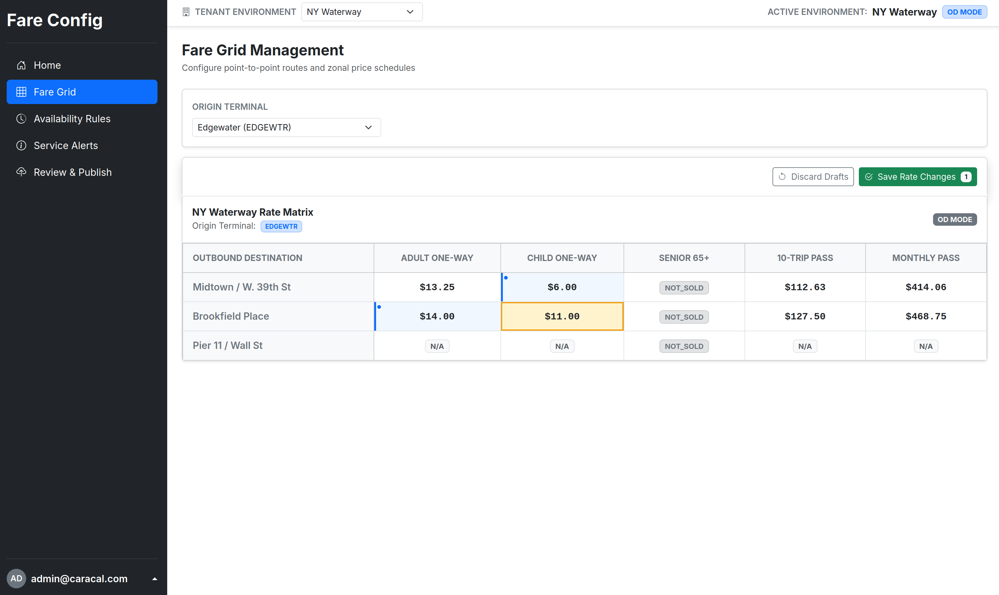
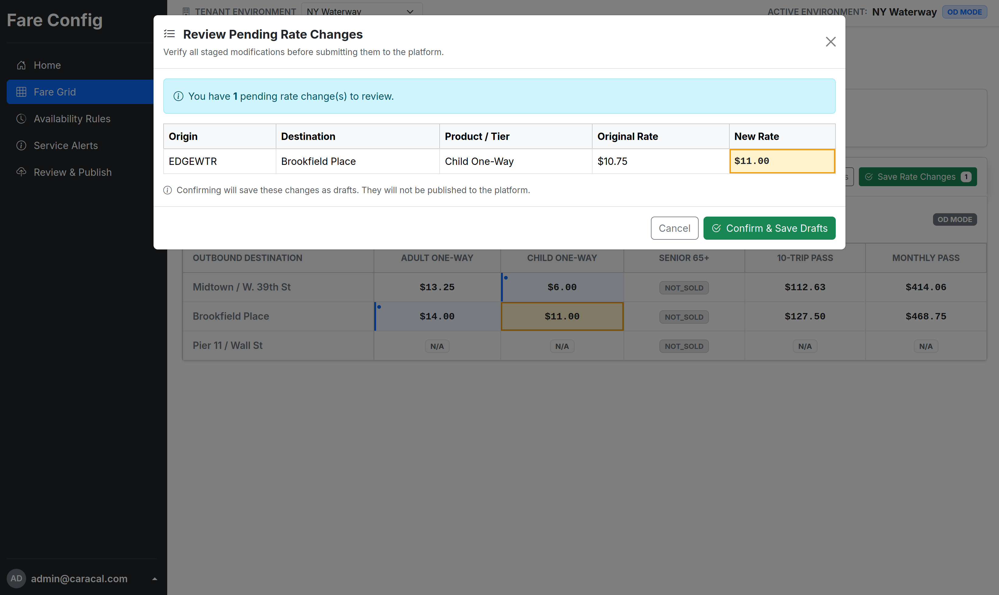

# NYW Fare Configuration & Management System

## Requirements and Specification Document

**Date:** 11/16/2026 | **Version:** v2.0 — Iteration 2

---

### Iteration 2 Change-Tracking Legend

To clearly indicate modifications since Iteration 1 for project markers, all text and structural changes in this document follow this color-coding convention:

* **Blue Text / Border:** Brand-new features, sections, or user stories added specifically for Iteration 2.
* **Amber Highlight:** Modifications, re-taggings (e.g., shifted from Iteration 1 to Iteration 2), or scope adjustments made based on client meetings.
* ~~Red Strikethrough:~~ Deprecated or explicitly removed features (such as Google Login and the TVM Kiosk canvas mockup) per client feedback.

---

## Preface & Version History

### Expected Readership

This document is prepared for CMPT 276 course instructors, teaching assistants, project markers, and system stakeholders (including client Eldon Wong). It defines the software requirements, system architecture, user stories, and development process for the NYW Fare Configuration & Management System.

### Version History & Rationale

* **v1.0 (Iteration 1):** Initial baseline proposal and foundational implementation. Established user authentication, basic role-based access control (`OPERATOR` and `CLIENT_SERVICES`), database connection, application shell, and initial static UI mockups.
* **v2.0 (Iteration 2):** Current production release. Introduces interactive Point-to-Point (O-D) and Zonal rate editing matrices, local PostgreSQL draft persistence, client-side currency input masking, real-time draft status counters, single-cell and global revert workflows, bilingual (EN/ES) service alert management, temporal sales window configuration, and staging review diff interfaces. Deprecates Google Login to concentrate resources on core backend and frontend validation.

---

## Introduction & Project Abstract

The NYW Fare Configuration & Management System is a centralized administrative web application designed to replace error-prone, manual JSON file manipulation with a robust, structured interface. It empowers transit operators and administrators to manage complex fare grids, schedule availability rules, and pre-purchase service alerts across multi-tenant environments (such as NY Waterway and Metra). The system interfaces with the underlying Caracal platform API while maintaining local staging workflows to prevent malformed configurations from reaching physical Ticket Vending Machines (TVMs).

### Customer

* **Primary Stakeholder:** Eldon Wong (Transit Operations & Systems Architect).
* **Operational Goals:** Eliminate manual JSON syntax errors, streamline rate updates across complex terminal topologies, provide immediate visual feedback on draft changes, and enable safe pre-staging review before platform dispatch.

### Competitive Landscape

Traditional transit configuration relies on raw spreadsheet editing and direct JSON file commits via Git repositories, which lack built-in validation constraints, role-based guardrails, or diff auditing. Our system introduces a dedicated administrative dashboard featuring strict input sanitization, multi-role access control, visual draft highlighting, and automated batch API validation.

---

## Team Process, Retrospective & Velocity

### Iteration 1 Retrospective & Process Improvements

Following Iteration 1, the team conducted a retrospective and identified several areas for workflow optimization:

1. **Work Distribution:** In Iteration 1, certain tasks were front-loaded or concentrated near deadlines. For Iteration 2, the team established strict vertical slicing and distributed tasks evenly across all five members.
2. **Branching & PRs:** All development strictly uses feature branches (`feature/epicX-...`) with mandatory Pull Requests and peer code reviews before merging into `main` and passing of automated unit tests using our github actions workflow.

### Iteration 2 Velocity & Sprint Progress

TODO: UPDATE THIS TO THE CORRECT VELOCITY CALCULATED IN THE GITHUB PROJECTS KANBAN

* **Iteration 1 Completed Velocity:** ~14 story points.
* **Iteration 2 Planned Velocity:** 18 story points (~1–2 story points per team member per week, aligned with course guidelines).
* **Status:** All planned Epic 2 and Epic 4 stories are fully implemented, tested, and integrated into the Render deployment.

### Work Distribution

* **Harendeep Singh:** Epic 1 Lead (Security, `ActorService` identity tracking, RBAC enforcement, and backend verification).
* **Oliver Tadaniewicz:** Epic 2 Lead & DevOps (Interactive Rate Grid, PostgreSQL `FareDraft` persistence, inline masking, 3-way zonal modal, GitHub Actions CI, Render deployment, and document compilation).
* **Athan Liu:** Epic 3 Lead (Terminal/Route availability toggles, permanent phase-out handling, and temporal sales window configuration).
* **Tejas Dutt:** Epic 4 Lead (Bilingual service alert management, multi-date/multi-route assignment, and TVM simulator interface).
* **Lakshya Joshi:** Epic 5 Lead (Configuration staging review diff interface `/publishing/review`).

---

## Application Access

To facilitate rapid grading and testing without troubleshooting registration errors, the pre-seeded test accounts are active on the production deployment:

* **Web Application URL:** [https://nyw-fare-config.onrender.com](https://nyw-fare-config.onrender.com) (or local development instance when integrating caracal's API)
* **Git Repository:** [https://github.com/sfu-cmpt276/nyw-fare-config](https://github.com/sfu-cmpt276/nyw-fare-config)

::: {.it2-added}
## User Interface Requirements & Iteration 2 Implementation

### Interactive O-D Fare Grid with Pending & Unsaved Drafts
{width=90%}

### O-D Fare Grid Draft Review Modal
{width=90%}
:::

---
